## Hi, I'm Raj 👋

I've spent 10+ years designing and scaling the backend systems brands run on: ERP, CRM, CMS, SaaS and e-commerce platforms, REST APIs, AI integrations, workflow automation and AWS infrastructure. I lead teams and own systems end to end, from the database schema to deployment.

- 🏢 Technical Lead at **Abhikant Digital Ads** (Dec 2023 – present)
- 🛍️ E-commerce on **Shopify**, Magento, WordPress and OpenCart: custom checkout and catalogue logic, apps, extensions and integrations
- 🚀 80+ projects delivered · 15+ developers led · 16 live platforms
- 🤖 Recent focus: AI API integrations, automation and data extraction pipelines
- 🤝 Open to full-time, part-time, contract and freelance work

🌐 **Website:** [rajtiwariyng.vercel.app](https://rajtiwariyng.vercel.app/) &nbsp;|&nbsp; 💼 [LinkedIn](https://www.linkedin.com/in/rajkrtiwari/) &nbsp;|&nbsp; 📫 [rajtiwariyng@gmail.com](mailto:rajtiwariyng@gmail.com) &nbsp;|&nbsp; 📄 [Résumé](https://rajtiwariyng.vercel.app/Raj-Tiwari-Resume.pdf)

---

## 🛠️ Tech stack

**Backend** 

**Frontend** 

**Databases, search & cache** 

**Cloud & DevOps** 

**E-commerce & CMS** 

**AI & automation:** OpenAI API · Claude API · chatbots · queues & cron jobs · web crawling · data extraction

---

## 🌍 Live platforms I've helped build

Most of my work is private client code, so here are some of the live sites instead:

| E-commerce | Corporate & financial |
| --- | --- |
| [Lacoste India](https://www.lacoste.in/) | [Hero FinCorp](https://www.herofincorp.com/) |
| [Kama Ayurveda](https://www.kamaayurveda.in/) | [TOTO India](https://in.toto.com/) |
| [Merino Laminates](https://www.merinolaminates.com/en/) | [Dulux Professional](https://www.duluxprofessional.com/in/en) |
| [Cottons & Satins](https://cottonsandsatins.com/) | [Aethyrtech](https://aethyrtech.ai/) |
| [FOS Lighting](https://www.foslighting.in/) | [Chanderpur](https://www.chanderpur.com/) |

👉 See all 16 on my [website](https://rajtiwariyng.vercel.app/profile#case-studies).

---

## 💼 Experience

| Role | Company | Years |
| --- | --- | --- |
| Technical Lead | Abhikant Digital Ads Pvt. Ltd. | 2023 – present |
| Senior Backend Developer | Karmatech Mediaworks Pvt. Ltd. | 2019 – 2023 |
| Senior Magento Developer | Vasudev Accounting Pvt. Ltd. | 2018 – 2019 |
| Magento Developer | Techpapa Pvt. Ltd. | 2018 |
| Magento Developer | YNG Media Pvt. Ltd. | 2016 – 2017 |

---

💬 **Have a complex system to build?** Email me at [rajtiwariyng@gmail.com](mailto:rajtiwariyng@gmail.com) or reach out on [LinkedIn](https://www.linkedin.com/in/rajkrtiwari/).
